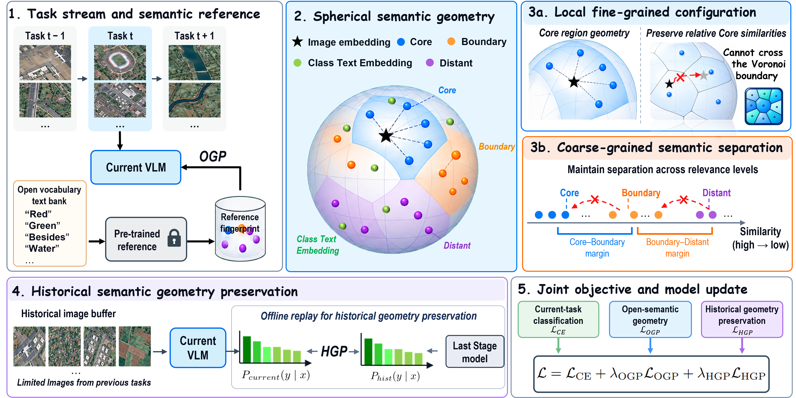

<h1 align="center">UniGP</h1>
<p align="center"><strong>Beyond Forgetting: Preserving Future Adaptability in Continual Learning of Remote Sensing Vision–Language Models</strong></p>
<p align="center">
  <a href="#method">Method</a> · <a href="#reported-results">Results</a> · <a href="#quick-start">Quick start</a> · <a href="#evaluation">Evaluation</a>
</p>

## Method

UniGP adapts OpenAI-pretrained CLIP ViT-B/16 to a sequence of remote sensing scene classification tasks. It updates the visual encoder and predicts among all seen classes without a task ID.



- **Open Geometry Preservation (OGP)** uses 719 open-vocabulary landmarks to preserve relative similarities within each image’s Core fingerprint and the separation between Core, Boundary, and Distant landmarks.
- **Historical Geometry Preservation (HGP)** caches class probabilities for memory images at each stage boundary and distills them over historical classes during the next stage.

The joint objective combines current-task cross-entropy with OGP and HGP, each weighted by 0.5 in the main experiments.

## Reported results

Manuscript classification accuracy in percent (mean ± standard deviation over three seeds).

| Dataset | Avg. ↑ | Last ↑ | FTAA ↑ |
|:--|--:|--:|--:|
| AID-30 | 94.75 ± 0.93 | 90.55 ± 1.38 | 92.85 ± 0.95 |
| NWPU-RESISC45 | 93.80 ± 0.70 | 88.86 ± 0.81 | 93.18 ± 0.66 |
| UC Merced | 92.58 ± 2.41 | 88.02 ± 3.62 | 93.06 ± 1.96 |

## Quick start

Use Python 3.10 or later and install PyTorch with CUDA support. From the repository root, install the dependencies.

```bash
pip install -r requirements.txt
```

OpenCLIP may download the pretrained weights on the first run. Supply your own dataset images.

| Dataset | Tasks × classes | Dataset layout | Memory per class |
|:--|:--|:--|--:|
| AID-30 | 6 × 5 | One folder per class | 20 |
| NWPU-RESISC45 | 5 × 9 | `train/train/<class>` and `test/test/<class>` | 20 |
| UC Merced | 7 × 3 | Class folders directly under the root or under `Images/` | 10 |

AID and UC Merced use a per-class 80/20 split with split seed 42. For NWPU, supply the pre-split data with 600 training and 100 test images per class.

```bash
python train.py --dataset aid  --data-root /path/to/AID  --seed 1 --samples-per-class 20
python train.py --dataset nwpu --data-root /path/to/NWPU --seed 1 --samples-per-class 20
python train.py --dataset ucm  --data-root /path/to/UCM  --seed 1 --samples-per-class 10
```

Repeat with seeds 2 and 3. The run seed also controls class order. The public entry point defaults to 10 epochs per stage, a batch size of 64, and AdamW with a learning rate of 1e-5 and weight decay of 0.01. The HGP temperature is 2. Use `python train.py --help` for the available options and distinct `--tag` values for experiment variants.

## Evaluation

Each run writes stage metrics and the task order under `results/<tag>/` and model checkpoints under `checkpoints/<tag>/`. Compute the manuscript metrics from the completed run’s `continual_capability.csv`.

| Metric | Calculation |
|:--|:--|
| Avg. | Mean of `seen_avg_acc` over all stages |
| Last | `seen_avg_acc` at the final stage |
| FTAA | Mean of `current_task_acc` from stage 2 onward |

Multiply the CSV accuracies by 100 to report percentages. The separate `next_task_zeroshot_acc` column measures zero-shot accuracy before learning the next task.

## Repository layout

- [`train.py`](train.py) contains the public training entry point.
- [`unigp/`](unigp/) contains the training loop, fingerprint construction, losses, and replay memory.
- [`protocols/`](protocols/) defines the datasets and task sequences.
- [`evaluation/`](evaluation/) computes and exports stage metrics.
- [`assets/vocabularies/`](assets/vocabularies/) contains the open vocabulary derived from NWPU-Captions.
